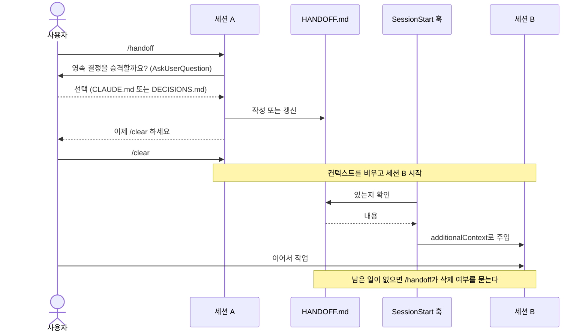

# handoff 하네스

세션을 짧게 여러 번 쓰기 위한 최소 구성입니다. 작업 단위가 끝나면 `/handoff`로 상태를 `HANDOFF.md`에 남기고 `/clear`로 컨텍스트를 비웁니다. 새 세션은 훅이 그 파일을 자동으로 넣어주기 때문에 이전 대화 없이 바로 이어가요. 파일 하나, 훅 한 줄, 명령 하나이고 평소에는 토큰을 쓰지 않습니다.

## 흐름



auto compact는 막지 않습니다. `compact` 매처가 직전 handoff를 다시 넣어주는 것까지만 해요.

## 파일

| 파일 | 역할 |
|---|---|
| `.claude/skills/handoff/SKILL.md` | 규칙과 절차. `disable-model-invocation: true`라 호출 전에는 토큰을 쓰지 않는다 |
| `.claude/skills/handoff/template.md` | HANDOFF.md 골격 6섹션 |
| `.claude/settings.json` | SessionStart 훅 한 줄. `$CLAUDE_PROJECT_DIR/HANDOFF.md`가 있으면 stdout으로 출력해 컨텍스트에 넣고, 없으면 조용히 종료. `startup`, `resume`, `clear`, `compact`에 등록 |

프로젝트 루트에는 `HANDOFF.md`가 생기고, 승격한 결정이 있을 때만 `CLAUDE.md` 한 줄 또는 `DECISIONS.md`가 생깁니다. 무엇을 쓰고 무엇을 쓰지 않는지는 `SKILL.md`의 규칙을 따릅니다.

## 사용법

```
/handoff   # 작성 또는 갱신. 끝나면 /clear
```

확인 방법: HANDOFF.md가 있는 상태에서 `/clear` 한 뒤 "이어서 할 일이 뭐야?"라고 물어보세요. 파일을 읽지 않고 답하면 훅이 동작한 겁니다. 프로젝트 설정의 훅은 폴더를 신뢰한 뒤에 동작해요.

## 전역으로 옮길 때

1. `.claude/skills/handoff/` → `~/.claude/skills/handoff/`
2. `.claude/settings.json`의 SessionStart 항목을 `~/.claude/settings.json`에 그대로 복사합니다. 훅 명령이 `$CLAUDE_PROJECT_DIR`만 참조하므로 고칠 곳이 없어요. 옮긴 뒤 프로젝트 `.claude/settings.json`의 항목은 지웁니다.
